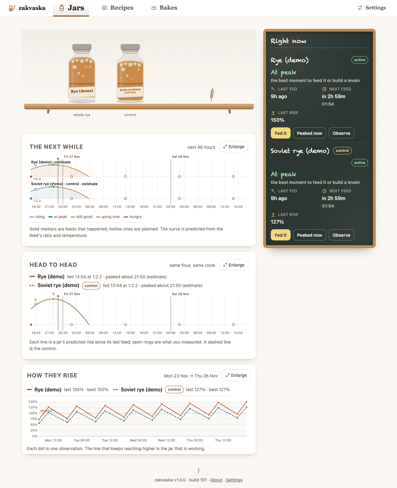
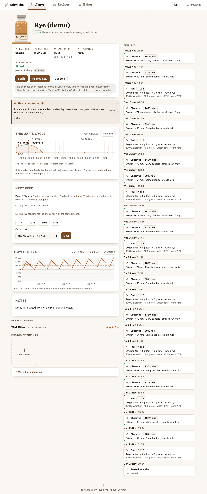
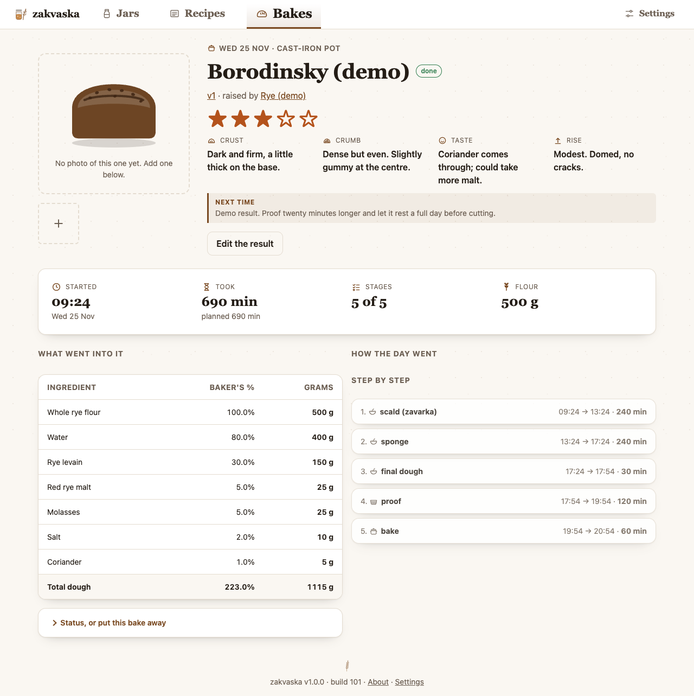
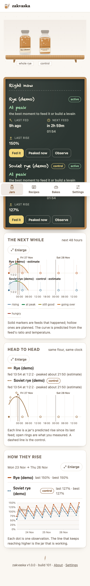

# zakvaska

**A lab notebook for sourdough starters and the bread that comes of them.**

*Zakvaska* (закваска) is Russian for a sourdough starter. This is the notebook
that sits beside the jar: when it was fed and with what, how high it rose, the
recipe as it stood the day you baked, and what you would change next time.



It runs on your own computer or a Raspberry Pi. There is no account, no cloud
and nothing to pay; everything you write stays in one folder that is yours.

## Why

A starter is an experiment that runs for months, and bread is what you learn
from it. Free-text notes cannot tell you whether the jar that peaks sooner
makes the better loaf, or what you changed between the dense one and the good
one. So this keeps the record as data:

- **Jars** are fed, measured and photographed on a timeline, and two jars on
  the same flour are drawn against each other. It was built to compare a
  homemade whole-rye starter with a purchased rye culture, the control, on the
  way to a proper Borodinsky.
- **Recipes** are baker's percentages, and versioned: editing one writes a new
  version, so last month's loaf still means what it meant.
- **Bakes** are planned against the clock and followed step by step, with a
  ring for each step, the preheat, the folds and the lid. Then the result is
  written up, and two loaves can be set side by side.
- **Alerts** tell you when a jar wants feeding, on your wall clock, around the
  hours you are asleep.

| A jar | A finished loaf | On a phone |
|---|---|---|
|  |  |  |

## Install

Two ways. Pick the **desktop app** if you want to double-click something and
bake. Pick **Docker** if you have a Raspberry Pi or a home server and want the
notebook on every phone and laptop in the house.

| | Desktop app | Docker |
|---|---|---|
| For | one computer | a Pi or server, used from any device on your network |
| Alerts | native notifications, even with the window closed | a banner on every page |
| Needs | macOS 11+ or Windows 10+ | Docker, on a 64-bit system |

### Desktop app (macOS, Windows)

1. Go to the [latest release](https://github.com/scottmclesly/zakvaska/releases/latest)
   and download the file for your computer:

   | Your computer | File |
   |---|---|
   | Mac with Apple Silicon (M1 and later) | `Zakvaska_x.y.z_aarch64.dmg` |
   | Mac with an Intel processor | `Zakvaska_x.y.z_x64.dmg` |
   | Windows | `Zakvaska_x.y.z_x64-setup.exe` |

   Not sure which Mac? Apple menu → About This Mac: "Chip: Apple M…" is Apple
   Silicon, "Processor: Intel" is Intel.

2. **Mac:** open the `.dmg` and drag Zakvaska onto Applications.
   **Windows:** run the installer.

3. Open it. **The first time, your system will stop you**, because the app is
   not yet signed with a paid developer certificate. It is safe to go on; here
   is how.

   **macOS 15 (Sequoia) and later**
   1. Double-click Zakvaska. A message says Apple could not verify it. Press **Done**.
   2. Open **System Settings → Privacy & Security** and scroll down to *Security*.
   3. Beside "Zakvaska was blocked…", press **Open Anyway**, and confirm.
   4. Press **Open Anyway** once more in the message that follows.

   **macOS 11 to 14**
   1. In Applications, hold Control and click Zakvaska (or right-click), and choose **Open**.
   2. In the message, press **Open**.

   **Windows**
   1. A blue box says "Windows protected your PC". Press **More info**.
   2. Press **Run anyway**.

   This is needed once. After that it opens like any other app.

4. Allow notifications when asked, so a feed that is due can tell you.

**Closing the window does not quit.** zakvaska stays in the system tray (the
menu bar on a Mac, beside the clock on Windows) so alerts keep coming. The tray
icon's menu opens the window again, checks for updates, shows the folder the
notebook is kept in, sets whether it starts when you log in, and quits.

Your notebook is kept in your own app-data folder, and updating or reinstalling
the app never touches it:

- macOS: `~/Library/Application Support/io.github.scottmclesly.zakvaska`
- Windows: `%APPDATA%\io.github.scottmclesly.zakvaska`

**Updating:** tray icon → *Check for updates…*. If there is a newer one,
download it and install it over the old.

### Docker (Raspberry Pi, or any Linux box)

On the Pi, one line installs Docker if it is missing, fetches zakvaska, works
out your time zone, starts it and tells you the address to open:

```bash
curl -fsSL https://raw.githubusercontent.com/scottmclesly/zakvaska/main/scripts/docker-install.sh | sh
```

That is all. It starts again by itself after a reboot. Open the address it
prints, `http://<the Pi's address>:8420`, on any phone or computer on your
network; on a phone, "Add to Home Screen" gives it an icon of its own.

**To update, run the same line again.** Your notebook is kept in a Docker
volume called `zakvaska-data`, and updating does not touch it.

It needs a 64-bit system: Raspberry Pi OS (64-bit) on a Pi 3 or newer.
[The script](scripts/docker-install.sh) is short and says what it does at the
top, if you would like to read it before running it.

<details>
<summary>Already use Docker? The two files, by hand</summary>

Save [`docker-compose.yml`](docker-compose.yml) into a folder and, in it:

```bash
docker compose up -d
```

Nothing needs editing. Two settings are optional, in a file called `.env`
beside it:

```bash
ZAKVASKA_PORT=8420            # the port you open in the browser
ZAKVASKA_TZ=America/New_York  # your time zone, so feeds ring on your clock
```

| To | Run |
|---|---|
| update | `docker compose pull && docker compose up -d` |
| see the log | `docker compose logs --tail 50` |
| stop it (the notebook is kept) | `docker compose down` |
| build from this repository instead | `docker compose -f docker-compose.yml -f docker-compose.build.yml up -d --build` |

The image is `ghcr.io/scottmclesly/zakvaska`, built for `amd64` and `arm64`.
It runs as a non-root user, reports its health, and restarts unless you stop
it.

</details>

### From source

For working on it. Needs Python 3.12 or newer and nothing else.

```bash
./scripts/setup.sh    # creates .venv, installs pinned deps, runs migrations
./scripts/run.sh      # http://127.0.0.1:8420
```

Settings go in `.env` (see [`.env.example`](.env.example)); set
`ZAKVASKA_HOST=0.0.0.0` to reach it from a phone.

## First run

An empty notebook offers a **demo**: two rye jars with a few days of feedings
and rise measurements, the recipe library, and one finished loaf. Load it to
look around. Everything it adds has "(demo)" in its name; archive the jars
when you are ready to start your own.

Starting for real is one button: **Add a jar**. The recipes page offers the
library on its own (33 reference recipes and a West Bend bread maker's
programs) without the pretend jars.

Before you trust it with months of feedings, look at **Settings → Backup**:
*Download everything* gives you one zip you can keep anywhere.

## Units

Weights are stored in grams, always. **Settings** chooses what you read and
type them as:

| Shown as | Good for |
|---|---|
| `grams` | the rye recipes, and the scale on the counter |
| `cups` | an American recipe written in cups and spoons |
| `oz / lb` | a bread-maker manual, or a scale set to imperial |

Cups and spoons are volume, so they need a density per ingredient — a cup of
rye flour is 103 g and a cup of water is 237 g. Those live in
`app/services/measures.py`, keyed by ingredient name with a fallback per role.
They are approximate on purpose: how hard you pack a cup of flour moves it by
a fifth, which is exactly why grams are what gets stored. Totals never show as
cups, because cups of mixed dough would be a made-up number.

Temperatures are set beside it: Fahrenheit or Celsius.

What is shown is also what a bare number is read as when you type one, and a
written-out unit always wins: "250 g", "1 lb 2 oz" and "1 ½ cups" mean what
they say whatever the setting.

## Feeding alerts

A job runs once a minute and marks a jar's feed as due, based on its last
feeding and the interval for its current state. Dormant and dried jars are
never chased. Alerts show as a banner on every page; you can snooze one
(30 min, 2 h, or any number of minutes) or dismiss it, and **feeding the jar
clears it automatically**.

Alert state lives entirely in the database and is recomputed on startup, so
restarting the app never loses one — anything that came due while it was down
fires immediately on the next start. Set `ZAKVASKA_SCHEDULER=0` to run without
the job.

### Browser notifications only work on the machine running it

While a tab is open, the page can also raise a desktop notification. The
browser Notification API is restricted to *secure contexts*, and
`http://localhost` counts as one but `http://192.168.x.x` does not — so
notifications work on the machine running the app and **not** on a phone over
the LAN. The in-app banner works everywhere.

Getting phone notifications means either serving over HTTPS or the ntfy push
planned for a later version. The desktop app does not have this limit: it
raises native notifications itself.

## Recipes

Ingredients are stored as **baker's percentages**: total flour is 100%, and
everything else is a percentage of the flour weight. The scale-to box on a
recipe page turns those into grams — give it either a total flour weight or
a target dough weight and it works the other out.

Levain is kept as its own line rather than being broken back into the flour
and water inside it, so the grams match what you actually weigh. That does
mean the hydration figure shown is the dough's *added* water, not its true
total.

Editing a recipe never changes it in place: every save writes a new version,
and old versions stay readable so a bake recorded against v1 still describes
what was made. The compare page shows what changed between any two versions,
matching lines by name rather than by position.

Equipment programs are the bread maker's programs, typed in from its manual,
so a bake can record which one was used.

## Bakes

A bake starts from a recipe *version*, never from the recipe, and the
version's stages are copied into it as a plan. Editing the recipe afterwards
leaves every bake alone — last month's loaf still means what it meant.

The bake page is a running sheet: tap a stage started, tap it done, and it
records the real times beside the planned ones with the difference. Notes go
in per stage. If the flour total is set, the page also shows the grams to
weigh out for that loaf.

The result is a rating out of five plus crust, crumb, taste, rise and — the
part that matters — what to change next time. Saving one marks the bake done.

A bread maker is sold by the pound its pan takes, so the start form has hot
buttons for the 2, 2.5 and 3 lb settings. Each one works backwards through the
recipe's percentages to the flour that fills that pan, and fills in the loaf
size too. The rating is the *dough* the pan holds; the baked loaf comes out
about a tenth lighter.

The bake list filters by recipe, jar, rating and status, and each bake also
shows up on the recipe version it came from and on the jar that raised it.

## Photos

A photo can hang off a jar, a feeding, an observation or a bake. The feeding
and observation forms take one as you log, so a jar gets photographed at the
moment it is worth photographing; everything else uploads from the gallery on
the detail page. On a phone the file field opens the camera directly.

Three files are written per upload, into `data/photos/YYYY/MM/` by the date the
photo was *taken*, not uploaded:

| File | What it is |
|---|---|
| `<id>_original.<ext>` | The upload, byte for byte. The lab record. |
| `<id>.jpg` | What pages show: oriented, EXIF stripped, 2048 px max. |
| `<id>_thumb.jpg` | 480 px, for galleries. |

Re-encoding the display copy does three things at once: the EXIF rotation is
applied to the pixels, so the photo is the right way up in any browser; the
rest of the EXIF block, GPS included, is dropped from the copy that gets
served; and a 12-megapixel phone photo stops being a 12-megapixel download on
every page view.

**HEIC** — what an iPhone shoots by default — is accepted, and is the reason
the display rendition exists rather than being a nicety: outside Safari, no
browser renders HEIC. Pages always show the JPEG; **Original** beside each
photo downloads the file as it arrived. Note that the original still carries
the camera's EXIF, GPS included; it lives in your data directory and is only
ever served by that explicit download.

`/photos/compare` puts two bake photos side by side with their ratings and
their "next time" notes, which is the only honest way to see a change in
crumb.

Photos are the one thing here that really deletes — a blurry shot of a jar lid
is not lab-notebook history, and a misfired upload needs an undo. Jars,
recipes and bakes are still archived, never deleted.

## The bread maker

`docs/reference/` holds the West Bend L5951 manual and a CSV of its cycle
chart, checked row by row against the chart on the manual's last page. The
twelve menu programs are seeded from that CSV's numbers, each with a row per
loaf size: knead 1, rest, knead 2, rise 2, stir down, rise 3, bake, total,
keep warm and the delay-start limit. The equipment page shows the whole table
under each program.

Why per size rather than one total: the machine runs a different clock for a
2 lb loaf than a 3 lb one — Basic is 3:00, 3:05 and 3:10 — so a single number
cannot say when the bread comes out. Working backwards from the hour you want
it out of the oven is a v2 job, and these are the numbers it needs.

A recipe version can name the program, loaf size and crust it expects, and
starting a bake from it opens the form with all three already set.

## Seeding

The recipes page has a button for this; from a source install it is also a
script:

```bash
./scripts/seed.sh --dry-run   # say what would happen, change nothing
./scripts/seed.sh             # do it
```

Add-only and safe to run twice. Programs are keyed on device and name,
recipes on name and source; anything already there is left exactly as it is,
children included, and reported as skipped. Nothing is ever updated or
deleted, so a recipe you have since edited never gains a version from a seed
run.

## Backup

Two ways out, for two different jobs.

**The export**, from the Backup page in the footer, is one zip holding every
table as JSON, the same rows again as CSV, and the photo files. The JSON is
what restores; the CSV is for whoever opens this in ten years without the app.
The same page reads an export back, in two steps: it checks the file right
through and shows it against what is here, and only then replaces. An export
from an older version is brought up to date on the way in, and the notebook as
it stood is saved to `backups/before-restore-<stamp>.zip` in the data folder
first, so a restore can itself be undone.

**The script**, for an install from source, takes a straight snapshot instead,
and is the one to put on a timer:

```bash
./scripts/backup.sh                 # into ./backups
./scripts/backup.sh /Volumes/stick  # somewhere else
./scripts/backup.sh --keep 14       # and prune to the newest 14
```

It copies the database through SQLite's online-backup API, so it is safe to run
while zakvaska is serving, and tars it up with the photos. To put one back, stop
zakvaska and untar it over the data directory:

```bash
tar -xzf backups/zakvaska-backup-20261101-1930.tar.gz -C data
```

Everything worth keeping is in `ZAKVASKA_DATA_DIR` (`./data` by default): back up
that directory and you have backed up the notebook.

## Development

```bash
.venv/bin/python -m pytest              # tests
.venv/bin/alembic revision --autogenerate -m "what changed"
./scripts/run.sh --reload               # needs: .venv/bin/pip install watchfiles
```

`GET /health` reports database connectivity and data-dir writability.

The stack is deliberately small: FastAPI, SQLite through SQLAlchemy, Jinja
templates with HTMX, and no JavaScript build step. Conventions and the
reasons for them are in [CLAUDE.md](CLAUDE.md).

| To | Read |
|---|---|
| build the desktop app yourself | [desktop/README.md](desktop/README.md) |
| cut a release | [docs/RELEASING.md](docs/RELEASING.md) |
| set up code signing | [docs/SIGNING.md](docs/SIGNING.md) |
| see what changed | [CHANGELOG.md](CHANGELOG.md) |

Bugs and ideas are welcome as
[issues](https://github.com/scottmclesly/zakvaska/issues/new/choose).

## Licence

[MIT](LICENSE). Use it, change it, bake with it.
